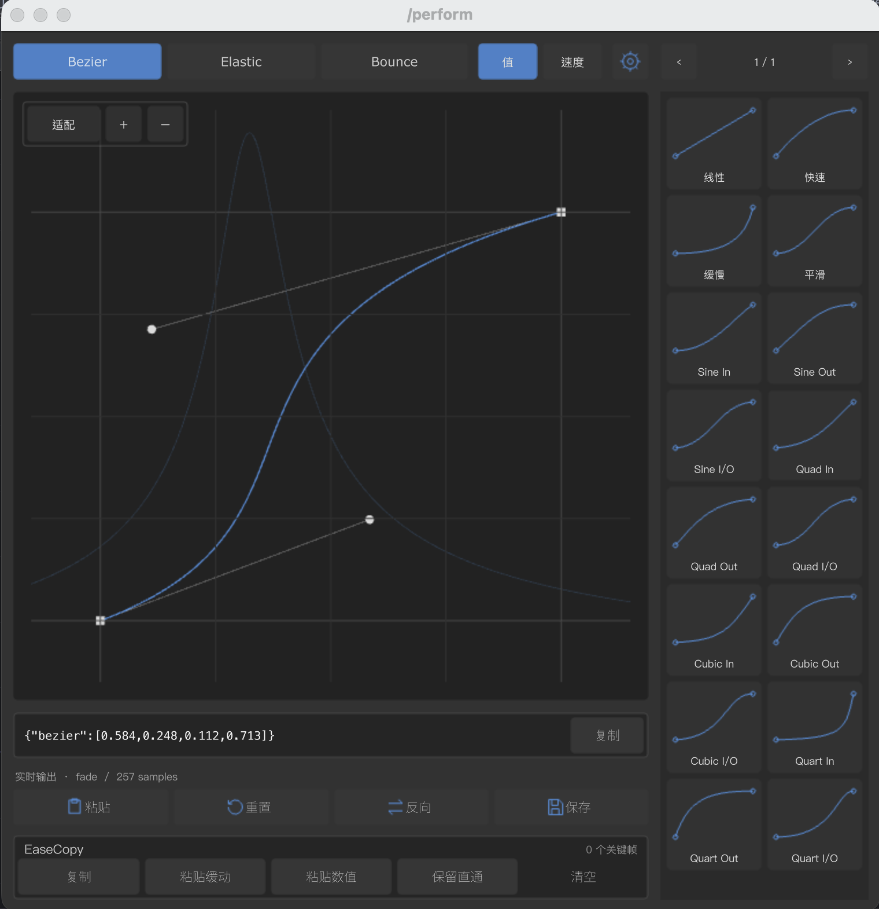

# Velo

**Native TouchDesigner curve editor · 原生 TouchDesigner 曲线编辑器**

[中文文档](README_CN.md) · [English documentation](README_EN.md) · [Download / 下载](https://github.com/luoboruodai/velo-curve-editor/releases/latest)

   



## Overview / 简介

Velo is a native COMP for editing **Bezier, Elastic and Bounce** curves in TouchDesigner. It combines multi-keyframe value editing, synchronized speed visualization, presets, EaseCopy and adaptive themes without WebRender, HTML or an external frontend runtime.

Velo 是原生 TD 曲线编辑组件，支持多关键帧、速度背景、预设、EaseCopy 和主题切换，无需浏览器或外部前端运行时。

## Download / 下载

- **Package / 发布包**: `Velo_v1.0.0_macOS_Windows.zip`
- **Direct component / 直接组件**: [`dist/Velo.tox`](dist/Velo.tox)
- **Evaluation copy / 评估副本**: `dist/Velo_Demo.tox`
- **Host / 宿主**: TouchDesigner 2025.31550 or a compatible later version / 或兼容的更新版本

The same native TOX is provided for macOS and Windows. **macOS is verified; Windows has not been runtime-tested in this environment.** / 同一原生 TOX 同时提供给 macOS 与 Windows；macOS 已验证，Windows 尚未在本环境实测。

## Install / 安装

1. Download and unzip the release / 下载并解压发布包。
2. Drag `Velo.tox` into your TouchDesigner network / 将 `Velo.tox` 拖入 TD 网络。
3. Connect the first CHOP output to your downstream network / 将第一个 CHOP 输出接入下游。

Output contract / 输出契约: one `fade` channel, 257 samples, endpoints `0 → 1` / 单通道 `fade`、257 个样本、首尾 `0→1`。

## Highlights / 特性

- Bezier / Elastic / Bounce curve models and synchronized speed display / 三类曲线与同步速度显示
- Multi-keyframe editing and monotonic-safe flexible Bezier handles / 多关键帧与保持时间正向的自由拉杆
- Preset browser, sorting, deletion, import/export / 预设浏览、排序、删除及导入导出
- EaseCopy copy, integer-multiple paste, ease/value separation, passthrough preservation / EaseCopy 复制、整数倍粘贴、缓动／数值分离及直通保留
- Adaptive accent themes, white handles and knobs, translucent glass view tools / 自适应主题、白色拉杆旋钮、半透明毛玻璃工具条
- Native CHOP output for downstream TD networks / 原生 CHOP 输出供下游使用

See [verification evidence](docs/VERIFICATION.md) / 查看[验证证据](docs/VERIFICATION.md)。

## Development / 开发

- `src/python/`: curve model, handle math, native layout, dialogs and EaseCopy / 曲线模型、手柄数学、原生布局、弹层与 EaseCopy
- `src/curve_editor.tox.dir/`: editable expanded native component / 可编辑展开组件
- `tools/`: UI generator, TOX build and regression tests / UI 生成器、TOX 构建与回归测试

Run tests / 运行测试：

```bash
for test in tools/test_*.py; do python3 "$test"; done
```

Build / 构建：

```bash
bash tools/build_tox.sh
```

## Documentation / 文档

- [中文说明](README_CN.md)
- [English documentation](README_EN.md)
- [Changelog / 更新日志](CHANGELOG.md)
- [Verification / 验证](docs/VERIFICATION.md)
