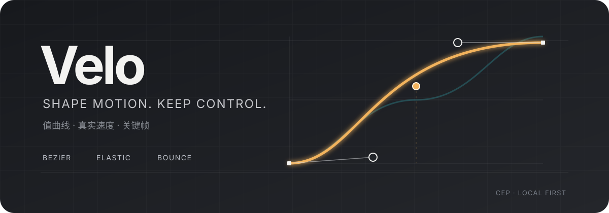

# Velo

[中文](README.zh-CN.md) · [After Effects guide](ae/README.md) · [Download v1.2.0](https://github.com/luoboruodai/velo-curve-editor/releases/tag/v1.2.0)



**Shape motion with direct curve, speed and keyframe control.** Velo is a local-first curve editor for After Effects, with Bezier, Elastic and Bounce models, multi-point editing, reusable presets and EaseCopy.

## Get Velo 1.2.0 for After Effects

1. Download **`VeloAE_v1.2.0_macOS_Windows.zip`** from the [v1.2.0 release](https://github.com/luoboruodai/velo-curve-editor/releases/tag/v1.2.0). This is the installable panel attachment, not GitHub's automatic *Source code* archive.
2. Check the ZIP against `VeloAE_v1.2.0_SHA256SUMS.txt` in the same release.
3. Follow the [English offline guide](ae/packaging/README.en.md) or [中文安装指南](ae/packaging/README.md).

No Node.js, Python, online account or additional extension is needed to use the panel. The Adobe CEP bridge is included locally.

## A curve editor built around motion

| Area | What you can do |
|---|---|
| Curve models | Edit Bezier, Elastic and Bounce, reverse a curve, and inspect the true derivative rather than an unrelated decorative line. |
| Multi-point editing | Insert points without changing the existing shape, drag anchors and handles, snap to continuous tangents, and switch between value and speed views. |
| Controlled deletion | Choose ordinary deletion or shape-preserving deletion. Smooth suitable redundant points while retaining extrema, pauses and necessary negative speeds. |
| After Effects output | Apply scalar native Temporal Ease or sampled arrays, Elastic/Bounce and multi-segment curves to consecutive numerical keyframes, with one undo group per application. |
| EaseCopy | Copy easing or numerical values independently, preserve the target's other property, use passthrough where appropriate, and undo a paste as one action. |
| Presets | Use 22 built-in presets, save user presets, reorder cards, hide built-ins, and export/import the complete configuration without overwriting existing user items. |
| Interface | Four languages, four preset locations, compact mode, adjustable cards and grid, custom colors, reduced motion and concise status notifications. |

The native AE tab stays simply **Velo**. The panel's short status remains next to the mode controls; longer feedback appears in a dismissible notification instead of squeezing the toolbar.

## Install in two steps

Quit AE, then copy `com.velo.curveeditor` from the extracted ZIP to your user CEP extensions folder:

- **macOS:** `~/Library/Application Support/Adobe/CEP/extensions/`
- **Windows:** `%APPDATA%\Adobe\CEP\extensions\`

Reopen AE and choose **Window → Extensions → Velo**. If your installation blocks unsigned CEP panels, see the offline guide for the scoped `PlayerDebugMode` setting; do not disable unrelated security protections.

Existing presets and settings remain on the local machine. Export important preset configurations before an upgrade.

## Compatibility and honest validation

| Item | Status |
|---|---|
| Package | One portable CEP ZIP for macOS and Windows; no platform-specific binary. |
| Manifest | AE `17.0` and later, CSXS `7.0`; declaration does not mean every version was exercised. |
| macOS host checks | After Effects 2026, build `26.5x89`, using isolated test objects. |
| Windows checks | Source, path, syntax and archive checks on Windows CI; **not a Windows AE host validation**. |
| Other hosts | This release is for AE only. Cavalry and TouchDesigner are not installed by this package. |

The release notes separate offline tests, CEP interaction, real AE writes, native file dialogs and unverified input/platform cases. A green CI run does not claim that AE is installed on the CI runners.

### Performance and size

Velo reuses sampled curves, thumbnails and unchanged state data. For a 12-segment microbenchmark, 28,000 repeated state-key reads no longer reserialize the segment array; scalar edits and segment replacement still invalidate the key. The measured key-path median decreased from about `2.46µs` to `0.92µs` on the recorded development machine. **This is not a claim of the same speedup for AE as a whole.**

The v1.2.0 package uses a small offline bilingual guide instead of the full historical development document. Readable source and the existing Adobe bridge are retained; no minifier or runtime dependency is added just to make the archive look smaller.

## TouchDesigner — native v1.1.0

[中文 TD 文档](README_CN.md) · [English TD documentation](README_EN.md) · [TD v1.1.0 download](https://github.com/luoboruodai/velo-curve-editor/releases/tag/v1.1.0) · [TD verification](docs/VERIFICATION.md)

The existing TouchDesigner product remains a **native COMP**, not a CEP panel. It uses native Panel, Text, Button, Script CHOP, Script SOP, Geometry and Render TOP nodes, without WebRender, HTML or an external frontend runtime. Its first output remains one `fade` CHOP channel with **257 samples and endpoints `0 → 1`**.

Features include multi-keyframe value editing, synchronized speed, presets, EaseCopy, adaptive themes and opt-in native Animation COMP export with **258 linear keys at frames 0–257**. Download `Velo_v1.1.0_macOS_Windows.zip` from the versioned TD release, drag `Velo.tox` into your network and connect the first CHOP output. macOS / TD 2025.31550 is verified; Windows is not runtime-verified in the recorded environment.

This AE release does not replace the TD source, TOX, documentation or release history. A one-click installer for AE, Cavalry and TouchDesigner is a later task, **not a feature of either current package**. Do not install the AE panel into TD or Cavalry and expect it to work.

## Develop and verify

The panel is dependency-free at runtime. From the repository root:

```bash
for file in ae/tools/test_*.js; do node "$file"; done
python3 ae/tools/test_panel_structure.py
python3 ae/tools/test_theme_tokens.py
python3 ae/tools/test_td_parity.py
python3 ae/tools/test_release.py
python3 ae/tools/build_release.py
```

`build_release.py` requires reviewed, committed release sources, checks both manifest versions and the host version, validates offline links and ZIP contents, and writes the archive, per-file manifest and SHA-256 file. A failed candidate does not replace the previous valid ZIP.

The [validation workflow](.github/workflows/ae-validation.yml) runs the offline checks on macOS, Windows and Ubuntu. Tagged builds additionally create a validation artifact; publishing the release remains an explicit action.

## Privacy, notices and contributions

- Curve editing and preset storage are local. Velo does not require an analytics or activation service.
- The Adobe bridge retains its original notices in `js/CSInterface.js`; see [third-party notices](ae/packaging/THIRD_PARTY_NOTICES.md).
- The banner is an original illustration, not a screenshot of a user's project.
- [Issues](https://github.com/luoboruodai/velo-curve-editor/issues) with the AE version/build, OS, reproduction steps and an isolated example are welcome. Do not upload private projects or credentials.

[Release notes](docs/RELEASE_v1.2.0.md) · [中文说明](README.zh-CN.md) · [TouchDesigner history](https://github.com/luoboruodai/velo-curve-editor/releases)
