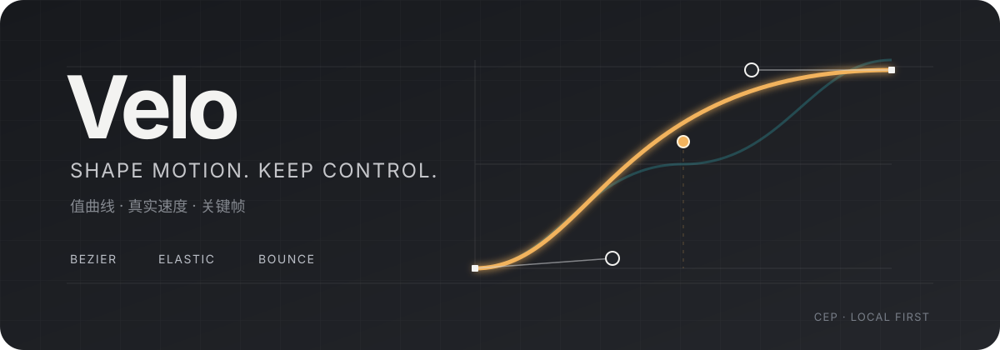

# Velo

[English](README.md) · [AE 完整指南](ae/README.md) · [下载 v1.2.1](https://github.com/luoboruodai/velo-curve-editor/releases/tag/v1.2.1)



**直接控制值曲线、真实速度与关键帧。** Velo 是一个本地优先的 After Effects 曲线编辑器，支持 Bezier、Elastic、Bounce、多点位编辑、预设与 EaseCopy。

## 获取 Velo 1.2.1 AE 版

1. 从 [v1.2.1 发布页](https://github.com/luoboruodai/velo-curve-editor/releases/tag/v1.2.1)下载 **`VeloAE_v1.2.1_macOS_Windows.zip`**。这是可安装面板附件，不是 GitHub 自动生成的 *Source code* 源码包。
2. 使用同一发布页的 `VeloAE_v1.2.1_SHA256SUMS.txt` 核对 ZIP。
3. 阅读[中文离线安装指南](ae/packaging/README.md)或 [English guide](ae/packaging/README.en.md)。

使用时不需要 Node.js、Python、在线账户或其他扩展，Adobe CEP 桥库已随面板本地提供。

## 围绕运动编辑曲线

| 功能 | 用途 |
|---|---|
| 曲线模型 | 编辑 Bezier、Elastic、Bounce，反向曲线，查看真实导数，而不是与输出无关的装饰速度线。 |
| 多点位 | 保形插点、拖动锚点和手柄、切线连续吸附，并在值／速度视图使用同一曲线模型。 |
| 删除与平滑 | 可选择普通删除或保形删除；对合适的冗余点减点，保留极值、停顿和必要的负速度。 |
| AE 输出 | 读取已选关键帧的数值与切线；可表示的多段 Bezier 按可见锚点写入原生关键帧与 Temporal Ease，一次撤销。保形隐藏节点及共享空间负速度使用明确标注的局部采样。 |
| EaseCopy | 分别复制缓动或数值，保留目标的另一项属性，支持直通，粘贴可一次撤销。 |
| 预设 | 22 个内置预设、用户预设、卡片排序、内置隐藏、完整配置导入导出；冲突 ID 重映射而不覆盖已有内容。 |
| 界面 | 四语言、四向预设布局、紧凑模式、卡片／网格调整、自定义颜色、减少动效与简短状态通知。 |

原生 AE 标签只显示 **Velo**。短状态位于模式按钮旁，完整提醒使用可关闭的通知，不再挤压工具栏。

## 离线一键安装器

- **Windows：** 下载并运行 `VeloInstaller_v1.2.1_Windows.exe`。
- **macOS：** 下载 `VeloInstaller_v1.2.1_macOS.zip`，解压后打开 `VeloInstaller.app`。应用使用 ad-hoc 签名，未经过公证，Gatekeeper 仍可能提示开发者身份未知。
- 安装器校验内嵌面板，默认完整备份旧版本，保留本机设置，失败自动回滚。不会自动关闭 AE，也不需要管理员权限；安装后请重新启动 AE。
- Cavalry 与 TouchDesigner 安装器尚未提供。

也可以继续手动安装面板 ZIP。

## 两步安装

先退出 AE，再将 ZIP 中的 `com.velo.curveeditor` 文件夹复制到用户 CEP 扩展目录：

- **macOS：** `~/Library/Application Support/Adobe/CEP/extensions/`
- **Windows：** `%APPDATA%\Adobe\CEP\extensions\`

重新打开 AE，选择 **窗口 → 扩展 → Velo**。若本地未签名面板被拦截，请按离线指南仅为对应 CSXS 版本设置 `PlayerDebugMode`，不要关闭无关的系统安全保护。

设置和预设保存在本机。升级前建议先导出重要的预设配置。

## 兼容性与验证边界

| 项目 | 状态 |
|---|---|
| 安装包 | 通用 CEP ZIP，以及 macOS `.app` 和 Windows `.exe` 原生安装器；无需下载运行时。 |
| 清单 | AE `17.0` 及以上、CSXS `7.0`；声明兼容范围不等于全部版本已实测。 |
| macOS 宿主 | 在隔离测试对象中使用 After Effects 2026（`26.5x89`）验收。 |
| Windows | 在 Windows CI 做源码、路径、语法和归档检查，**没有 Windows AE 实机认证**。 |
| 其他宿主 | 本版本只做 AE；不会向 Cavalry 或 TouchDesigner 安装此面板。 |

发布说明分别记录离线测试、CEP 交互、真实 AE 写入、原生文件窗口和未覆盖的输入／平台。CI 通过不代表 CI 机器安装了 AE。

### 性能与体积

采样、缩略图和未变化状态数据会复用。12 段曲线的独立测量中，28,000 次重复状态键读取不再重复序列化分段数组；标量编辑和分段替换仍会使缓存失效。记录机器上该计算路径的中位耗时约由 `2.46µs` 降至 `0.92µs`，**不表示 AE 整体也有相同提速比例**。

安装包使用精简的离线双语指南，完整历史开发文档留在源码仓库。保留可读源码和 Adobe 桥库，不为了缩小数字而引入新的压缩工具或运行时依赖。

## TouchDesigner 与安装器边界

现有 [TouchDesigner v1.1.0](https://github.com/luoboruodai/velo-curve-editor/releases/tag/v1.1.0) 是独立的 TD 原生 COMP／TOX 产品，其功能和发布历史继续保留。本次 AE 发布不会替换它。

本次已提供 AE 原生一键安装器；Cavalry 与 TouchDesigner 安装器仍是后续工作。不要把 AE 面板复制到 TD 或 Cavalry 并期望正常工作。

## 开发与验证

面板运行时无外部依赖。在仓库根目录执行：

```bash
for file in ae/tools/test_*.js; do node "$file"; done
python3 ae/tools/test_panel_structure.py
python3 ae/tools/test_theme_tokens.py
python3 ae/tools/test_td_parity.py
python3 ae/tools/test_release.py
python3 ae/tools/build_release.py
```

`build_release.py` 要求发布源码已经审查并提交，检查两处 manifest 和宿主版本、离线链接、ZIP 内容，生成归档、逐文件清单及 SHA-256。候选校验失败不会覆盖已有有效包。

[验证工作流](.github/workflows/ae-validation.yml)在 macOS、Windows 和 Ubuntu 运行离线检查；标签构建还在对应系统构建并 CLI 测试原生安装器，再验证面板包。正式发布仍是单独的人工授权动作。

## 隐私、声明与参与

- 曲线编辑和预设存储在本地，不需要分析或激活服务。
- Adobe 桥库保留原始声明，见[第三方声明](ae/packaging/THIRD_PARTY_NOTICES.md)。
- 顶部插图是原创品牌图，不是用户工程截图。
- 欢迎通过 [Issues](https://github.com/luoboruodai/velo-curve-editor/issues) 提供 AE 版本／build、操作系统、复现步骤和隔离示例；不要上传私有工程或凭据。

[版本说明](docs/RELEASE_v1.2.1.md) · [English](README.md) · [TouchDesigner 发布历史](https://github.com/luoboruodai/velo-curve-editor/releases)
