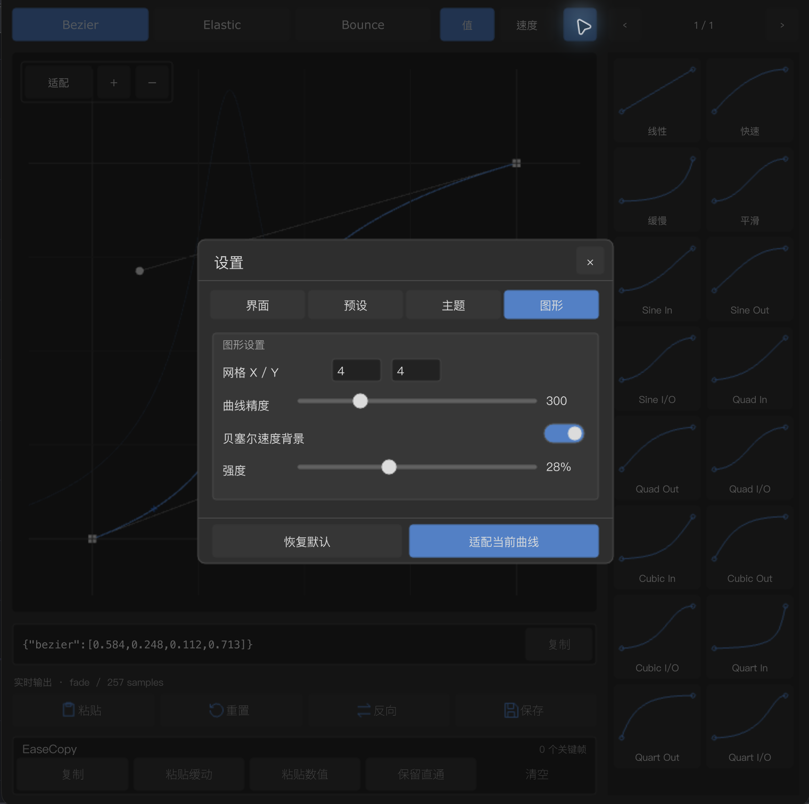

# Velo — Native TouchDesigner Curve Editor

Velo is a native TouchDesigner COMP for **Bezier, Elastic and Bounce** curve editing. It is built with native Panel, Text, Button, Script CHOP, Script SOP, Geometry and Render TOP nodes—no WebRender, HTML browser, external frontend runtime or TD global-theme changes.


## Features

### Curve editing

- Multi-keyframe value curves with synchronized speed visualization.
- Independent Bezier speed-editing view using the same cubic model.
- Flexible Bezier handles with finite coordinates and exact monotonic-time protection.
- Elastic and Bounce parameters with labeled sliders and readable values.
- Value and speed use the same sampling model rather than separate approximations.

### Presets and EaseCopy

- Built-in and user presets, ordering, deletion, import/export and card-size adjustment.
- Single-key or range copy, integer-multiple paste, ease-only or value-only paste.
- Preserve passthroughs and clear the copy buffer.
- The EaseCopy panel has a dedicated title/buffer row and a separate action row.

### Interface and themes

- Adaptive accent colors for curves, thumbnails, selected states and functional icons.
- White Bezier handles, anchors and slider knobs that do not follow the accent theme.
- Floating translucent glass view controls and coordinated speed-segment controls.
- Redesigned settings with visible switch/slider tracks and transparent in-section captions.

## Installation

1. Download `Velo_v1.0.0_macOS_Windows.zip` from [Releases](https://github.com/luoboruodai/velo-curve-editor/releases/latest).
2. Unzip it and drag `Velo.tox` into your TouchDesigner network.
3. Connect the first CHOP output to the downstream node that needs the fade signal.

`Velo_Demo.tox` is an identical evaluation copy of the same component; it is not a reduced or differently featured build.

## Output and compatibility

- First output: CHOP channel `fade`.
- Samples: 257.
- Endpoint values: `0.0` and `1.0`.
- Host used for verification: TouchDesigner **2025.31550** on **macOS**.
- Windows: the same native TOX is provided for TouchDesigner on Windows. It contains no macOS-specific file paths or external runtime dependency. **Windows has not been runtime-tested in this environment.**

## Usage notes

- Drag keyframes and handles directly; the view expands when a handle is released outside its previous bounds.
- Use **Fit** to include all Bezier anchors and handles in the viewport.
- Switch between value and speed editing without changing the underlying sampling contract.
- Preserve or clear the EaseCopy buffer explicitly; an empty buffer cannot be pasted.

## Development and verification

```bash
for test in tools/test_*.py; do python3 "$test"; done
bash tools/build_tox.sh
```

The release contains 67 passing offline regressions, repeated deterministic builds and native TouchDesigner checks. See [Verification](docs/VERIFICATION.md) and [Changelog](CHANGELOG.md).


